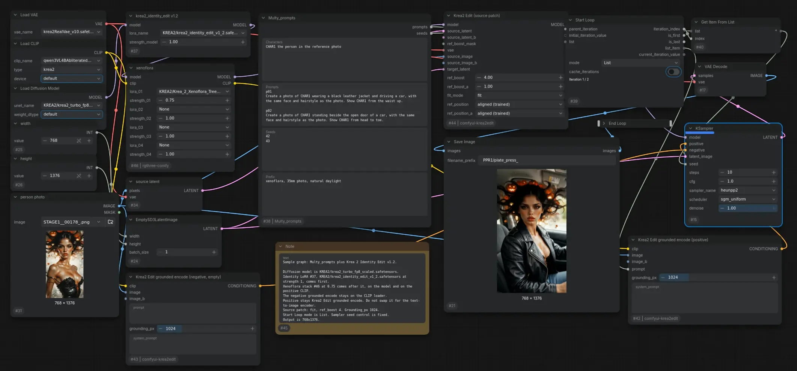

# Krea 2 reference image, Multy_prompts

One Krea 2 Turbo graph. Each plate from **Multy_prompts** is an edit of the same reference photo. The photo holds the person. The plate says what to add.

Load `krea2_identity_multy_prompts.json`.

## Requires

- ComfyUI-Multy_prompts in `custom_nodes`, for the plate and seed lists
- [ComfyUI-Krea2Edit](https://github.com/lbouaraba/comfyui-krea2edit) in `custom_nodes`
- [rgthree-comfy](https://github.com/rgthree/rgthree-comfy), for the style LoRA stack
- [ComfyUI-KJNodes](https://github.com/kijai/ComfyUI-KJNodes), for the second-reference switch
- Restart ComfyUI after installing any of these packs

Weights this graph asks for:

| Slot | File |
|---|---|
| Diffusion model | `KREA2/krea2_turbo_fp8_scaled.safetensors` |
| CLIP | `qwen3VL4BAbliteratedComfyui_v10_full_bf16.safetensors`, type `krea2` |
| VAE | `krea2RealVae_v10.safetensors` |
| Style LoRA | `KREA2/Krea_2_Xenoflora_Trees_tcrzit_BF16-3K.safetensors` at 0.75, on **Lora Loader Stack (rgthree)** |
| Identity LoRA | `KREA2/krea2_identity_edit_v1_2.safetensors` at strength 1 |

The identity LoRA is [krea2 identity edit v1.2](https://huggingface.co/conradlocke/krea2-identity-edit). The shared prefix starts with `xenoflora`, which is the style LoRA's trigger.

## Wiring

| From | To |
|---|---|
| Load Image | Krea2 Edit grounded encode `image` (positive and negative), VAE Encode `pixels`, and Krea2 Edit source patch `source_image` |
| VAE Encode | source patch `source_latent` |
| Empty latent | sampler `latent_image` and source patch `target_latent` |
| Diffusion model | identity LoRA (node 37), then the Xenoflora stack, then the single-photo source patch, then the second-reference switch, then the sampler |
| CLIP loader | Xenoflora stack `clip`, then the positive grounded encode |
| CLIP loader | negative grounded encode `clip`, past the stack |
| Multy_prompts `prompts` | Start Loop `list` |
| Start Loop `list_item` | positive grounded encode `prompt` |
| Multy_prompts `seeds` | Get Item From List `list` |
| Start Loop `iteration_index` | Get Item From List `index` |
| Get Item From List | sampler `seed` |
| VAE | decode, VAE Encode, and the source patch |
| Save Image `images` | End Loop `termination` |

Start Loop mode is **List**. The sampler seed control is **fixed**. The negative grounded encode keeps an empty prompt and the same photo.

Source patch: `fit`, `ref_boost` 4, reference position `aligned (trained)`. Both encoders: `grounding_px` 1024. Output size is 768×1376.

Sampler is **euler**, scheduler **simple**, **8** steps, CFG **1**, denoise **1**. That is the Krea 2 Turbo schedule. ComfyUI already applies shift 1.15 on this model, so the graph has no extra shift node. Each plate still takes its seed from Multy_prompts.

## The photo

Use a full-body photo, or at least head and shoulders. The patch pins that crop onto the canvas. A face that fills the frame becomes a large head, and the plate cannot shrink it.

The Load Image widget points at `example.png`. Point it at your photo.

## Second reference

**2nd reference** is off until **2nd ref ON** is true. Off is the single-photo edit above, and the other branch does not run.

| 2nd ref ON | 2nd ref is STYLE (material) | What image 2 does |
|---|---|---|
| off | either | Ignored. |
| on | off | Character. Joins the identity edit as the subject. Image 1 stays the first reference. |
| on | on | Material, such as a marble paint or a texture. The person photo stays the subject, placed beside the canvas at ref boost 4, so a tight face is not pinned huge. Image 2 is material only: bag of features, ref boost 3. Lower that dial if the face slips. Raise it if the material is too weak. The identity edit patch stays on. |

## Plates

`CHAR1` is `the brunette woman from reference image1`. `CHAR2` is `the second person, a redhead woman from reference image2`. With the photos as loaded now, the brunette with the feather is in **person photo** and the redhead is in **2nd reference**. `p01` puts CHAR1 in the driver's seat and CHAR2 on the back seat in an orange vest. `p02` puts CHAR1 beside the open door and CHAR2 on the road in a green vest. The shared prefix still starts with `xenoflora`, then the 35mm daylight line, then one line that keeps the face and hair. Each sample plate states the new clothes, both hands, where the gaze lands, and where the camera sits.

Text-to-image with no reference photo is the sample in ComfyUI-Multy_prompts, `krea2_t2i_multy_prompts.json`. That graph includes a style LoRA and uses Text Encode Qwen Image Edit Plus for the plate.
